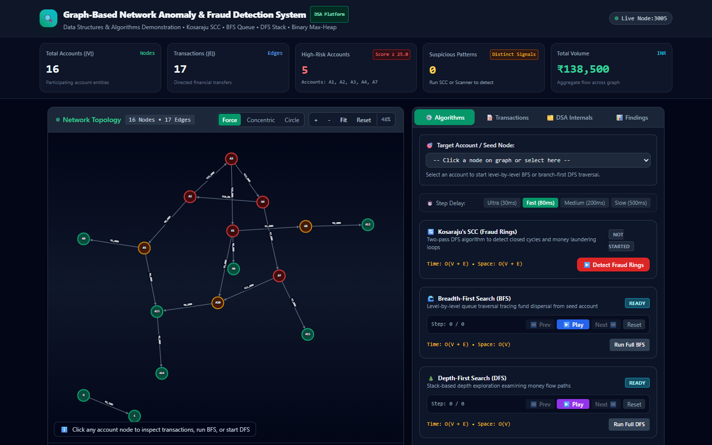
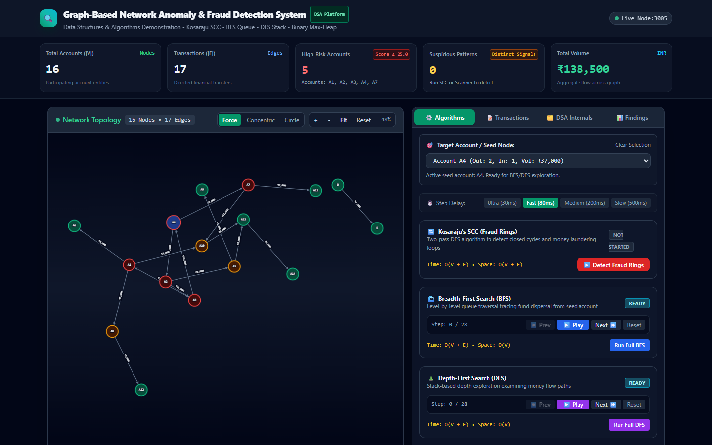
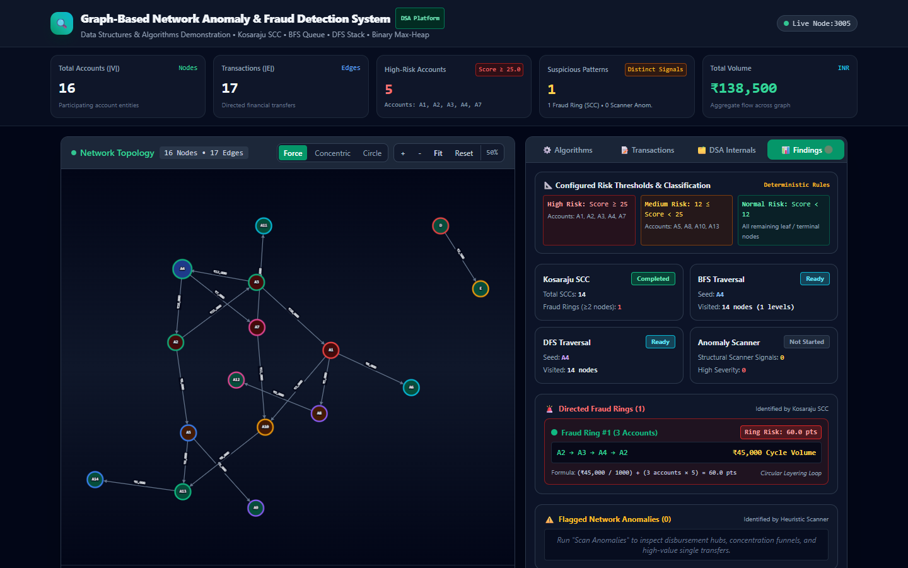
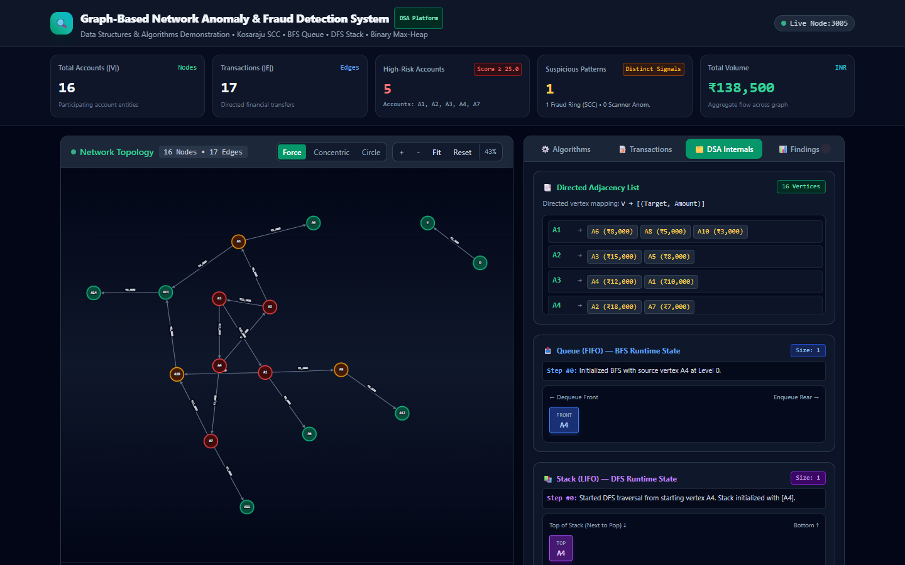
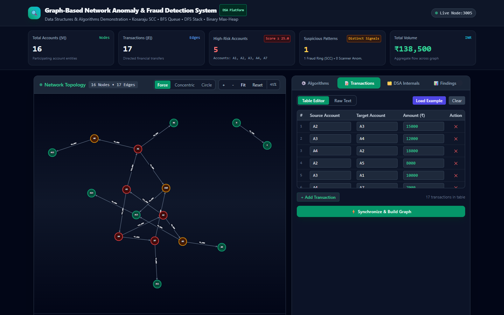
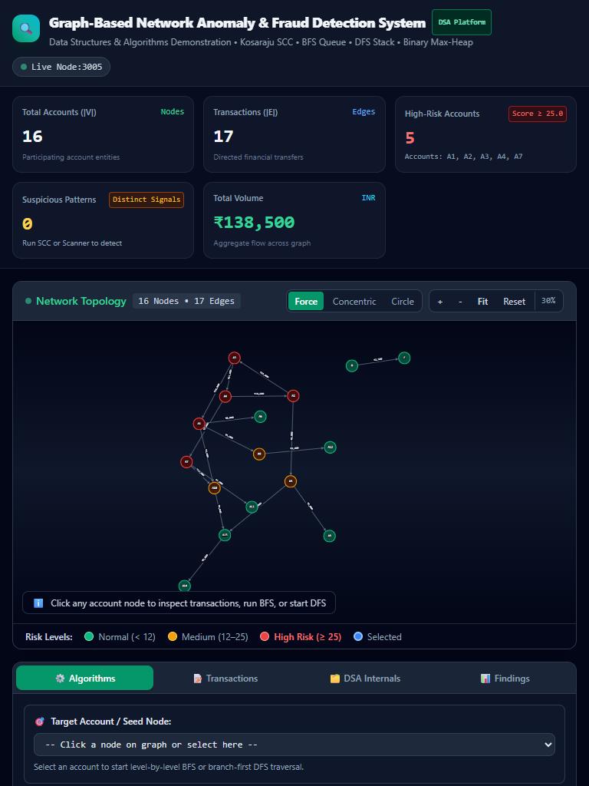

# Graph-Based Network Anomaly & Fraud Detection System

> **Enterprise-Grade Data Structures & Algorithms (DSA) Demonstration Platform**  
> A high-performance, interactive financial forensic analytics ecosystem designed to detect circular transaction layering, money-mule networks, and structural flow anomalies using classical graph algorithms, priority queues, and heuristic scanners.

---

## 🌟 Key Highlights & Architecture

- **Interactive Network Graph Engine:** Built with Cytoscape.js supporting Force-Directed (**COSE**), **Concentric**, and **Circular** layouts with collision prevention, dynamic zoom-to-fit, and account inspection drawers.
- **Kosaraju's Strongly Connected Components (SCC):** Real two-pass algorithm ($O(V + E)$ time & space) executing DFS finishing-time order in Pass 1 and transposed graph traversal in Pass 2 to isolate directed transaction cycles.
- **Accurate Directed Cycle Reconstruction:** Reconstructs the exact transaction flow sequence ($\mathbf{A2 \rightarrow A3 \rightarrow A4 \rightarrow A2}$) rather than undirected components.
- **Breadth-First Search (BFS) & FIFO Queue:** Interactive step-by-step level-order exploration with visual playback controls (Play, Pause, Step Forward, Step Back, Reset) and live FIFO queue state transitions.
- **Depth-First Search (DFS) & LIFO Stack:** Branch-first depth traversal demonstrating explicit stack push/pop operations with traversal order logging.
- **Calibrated Account Risk Score Engine:**
  $$\text{Risk Score} = (\text{OutDegree} \times 2) + (\text{ClusterSize} \times 3) + \left(\frac{\text{OutAmount}}{1000}\right)$$
  *$\text{ClusterSize}$ dynamically evaluates the size of the node's Strongly Connected Component (SCC).*
- **Binary Max-Heap Priority Queue:** Implements array-backed binary max-heap satisfying parent-child ordering property ($\text{Heap}[i] \ge \text{Heap}[2i+1], \text{Heap}[2i+2]$) for rapid $O(\log n)$ extraction of top risky accounts.
- **Heuristic Network Anomaly Scanner:** Flags **Disbursement Hubs** (fan-out structuring), **Aggregation Funnels** (fan-in consolidation), and **High-Value Single Transfers** ($\ge \text{₹}15,000$).
- **Financial Localization & Cross-Device Compatibility:** Formatted in Indian Rupee (**₹** / INR) with verified zero-overflow layouts across Desktop, Tablet, and Mobile screens.

---

## 📸 Screenshots Showcase

### 1. Network Topology & Operational Dashboard
*Interactive force-directed graph canvas with real-time KPI summary metric cards, layout selectors, and live node status.*



---

### 2. Account Inspector Drawer & Risk Score Derivation
*In-depth account investigation drawer displaying exact mathematical risk score derivation, outbound/inbound transaction volumes, and transfer records.*



---

### 3. Detected Fraud Rings & Forensic Findings
*Kosaraju SCC fraud ring breakdown featuring directed sequence $\mathbf{A2 \rightarrow A3 \rightarrow A4 \rightarrow A2}$, cycle volume of ₹45,000, and documented formula justification (60.0 pts).*



---

### 4. Data Structure Internals & Binary Max-Heap
*Live educational visualizers for Directed Adjacency List, BFS Queue (FIFO), DFS Stack (LIFO), Hash Map, and Binary Max-Heap array layout.*



---

### 5. Dual Transaction Management & Validation
*Synchronized Table Editor and Raw Text transaction input modes with real-time schema validation, edge creation, and graph rebuild capabilities.*



---

### 6. Responsive Tablet Experience (768 × 1024)
*Fluid tablet portrait view ensuring seamless algorithm execution, graph interactions, and zero horizontal page overflow.*



---

## 🛠️ Technology Stack

| Layer | Technologies |
| :--- | :--- |
| **Frontend Framework** | React 19, TypeScript |
| **User Interface & Styling** | Tailwind CSS, Custom Glassmorphic Dark Dashboard UI |
| **Graph Visualization** | Cytoscape.js (COSE, Concentric, Circular Layouts) |
| **Algorithms Engine** | Custom TypeScript DSA Engine (`MaxHeap`, `GraphAlgorithms`, Kosaraju SCC, BFS Queue, DFS Stack) |
| **Static Runtime Server** | Node.js High-Speed In-Memory Caching HTTP Server (`serve.js`) |
| **Testing & Verification** | Playwright, TypeScript Compiler (`tsc`), Node.js Test Harness (`verify-all-tests.js`) |

---

## 🚀 Quick Start Guide

### Option 1: High-Speed Production Server (Recommended)

Run the production bundle on Port 3005 with in-memory asset caching:

```bash
# 1. Clone repository
git clone https://github.com/nayanaastakar/Graph-Based-Network-Anomaly-and-Fraud-Detection-System.git
cd Graph-Based-Network-Anomaly-and-Fraud-Detection-System

# 2. Install dependencies
npm install

# 3. Build optimized production assets & serve
npm run build
npm run serve
```

Access the platform at: **[http://localhost:3005](http://localhost:3005)**

---

### Option 2: Local Development Server

Run the application with React development hot-reloading:

```bash
npm start
```

Access the development server at: **[http://localhost:3000](http://localhost:3000)**

---

## 🔐 Canonical Reference Dataset & Verified Metrics

The platform is pre-calibrated with an academic forensic transaction graph:

- **Total Accounts ($|V|$):** 16 accounts ($A1$–$A14$, $D$, $E$)
- **Total Transactions ($|E|$):** 17 directed transactions
- **Total Volume:** **₹138,500** (INR)
- **Strongly Connected Components:** 14 SCCs (1 cyclic multi-node ring + 13 singletons)
- **Detected Circular Fraud Ring:**
  - **Directed Path:** `A2 → A3 → A4 → A2`
  - **Cycle Internal Volume:** ₹45,000
  - **Mathematically Justified Score:**
    $$\text{Ring Score} = \left(\frac{\text{₹}45,000}{1000}\right) + (3 \text{ accounts} \times 5) = \mathbf{60.0 \text{ pts}}$$

### Exact Risk Scores & Binary Max-Heap Ranking

| Rank | Account ID | OutDegree | ClusterSize (SCC) | OutAmount (₹) | Formula Calculation | Risk Score | Risk Tier |
| :---: | :---: | :---: | :---: | :---: | :---: | :---: | :---: |
| **#1** | **A4** | 2 | 3 | ₹25,000 | $(2 \times 2) + (3 \times 3) + 25.0$ | **38.0** | **HIGH** |
| **#2** | **A2** | 2 | 3 | ₹23,000 | $(2 \times 2) + (3 \times 3) + 23.0$ | **36.0** | **HIGH** |
| **#3** | **A3** | 2 | 3 | ₹22,000 | $(2 \times 2) + (3 \times 3) + 22.0$ | **35.0** | **HIGH** |
| **#4** | **A1** | 3 | 1 | ₹16,000 | $(3 \times 2) + (1 \times 3) + 16.0$ | **25.0** | **HIGH** |
| **#5** | **A7** | 2 | 1 | ₹18,000 | $(2 \times 2) + (1 \times 3) + 18.0$ | **25.0** | **HIGH** |
| — | **A5** | 2 | 1 | ₹9,000 | $(2 \times 2) + (1 \times 3) + 9.0$ | **16.0** | MEDIUM |
| — | **A8** | 1 | 1 | ₹9,000 | $(1 \times 2) + (1 \times 3) + 9.0$ | **14.0** | MEDIUM |
| — | **A10** | 1 | 1 | ₹8,000 | $(1 \times 2) + (1 \times 3) + 8.0$ | **13.0** | MEDIUM |
| — | **A13** | 1 | 1 | ₹6,000 | $(1 \times 2) + (1 \times 3) + 6.0$ | **11.0** | NORMAL |
| — | **D** | 1 | 1 | ₹2,500 | $(1 \times 2) + (1 \times 3) + 2.5$ | **7.5** | NORMAL |
| — | **A6, A9, A11, A12, A14, E** | 0 | 1 | ₹0 | $(0 \times 2) + (1 \times 3) + 0.0$ | **3.0** | NORMAL |

---

## 📁 Repository Structure

```
Graph-Based-Network-Anomaly-and-Fraud-Detection-System/
├── docs/
│   └── images/                       # High-resolution showcase screenshots
│       ├── 01_network_topology_overview.png
│       ├── 02_account_inspector_drawer.png
│       ├── 03_fraud_rings_and_findings.png
│       ├── 04_dsa_internals_and_max_heap.png
│       ├── 05_transaction_management.png
│       └── 06_tablet_responsive_view.png
├── public/
│   ├── favicon.ico
│   └── index.html                    # HTML5 template with subpixel typography
├── src/
│   ├── components/
│   │   ├── AlgorithmLog.tsx          # Real-time algorithm audit trail
│   │   ├── AlgorithmStatusPanel.tsx  # Kosaraju SCC & Anomaly findings
│   │   ├── BFSTable.tsx              # Level traversal status table
│   │   ├── ControlPanel.tsx          # Traversal playback controls & seed selector
│   │   ├── DataStructureView.tsx     # Queue, Stack, Hash Map & Max-Heap
│   │   ├── EdgeInputPanel.tsx        # Table and Raw Text transaction input
│   │   └── GraphVisualization.tsx    # Interactive Cytoscape network canvas
│   ├── types/
│   │   └── algorithms.ts             # Complete TypeScript types & interfaces
│   ├── utils/
│   │   └── algorithms.ts             # Native DSA Engine: Kosaraju, BFS, DFS, Heap
│   ├── App.tsx                       # Main application shell & tab switcher
│   └── index.tsx                     # React root bootstrap
├── package.json                      # NPM configuration & cross-platform scripts
├── serve.js                          # Production HTTP caching static server
├── test-all-viewports.js             # 6-viewport automated compatibility suite
├── test-ui-interactions.js           # Headless browser interaction & console tester
├── verify-all-tests.js               # Comprehensive 57-assertion DSA regression suite
└── README.md                         # Project documentation and showcase
```

---

## 🧪 Automated Testing & Verification

Execute the 57-point automated verification suite covering algorithmic correctness, heap invariants, cycle paths, and deduplication:

```bash
npm test
```

Execute multi-viewport responsive testing across 6 screen resolutions (Mobile, Tablet, Laptop, Desktop):

```bash
node test-all-viewports.js
```

---

## 📄 License

This project is licensed under the MIT License - see the [LICENSE](LICENSE) file for details.
